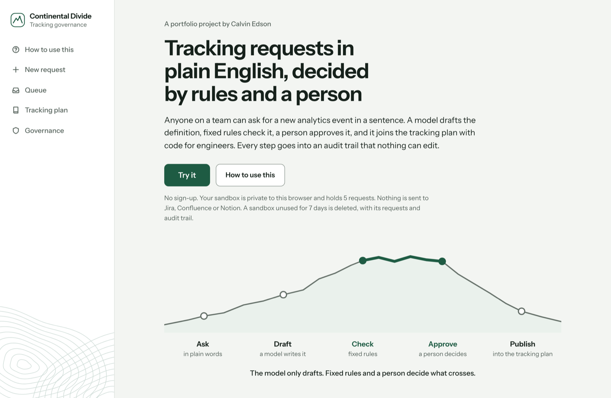
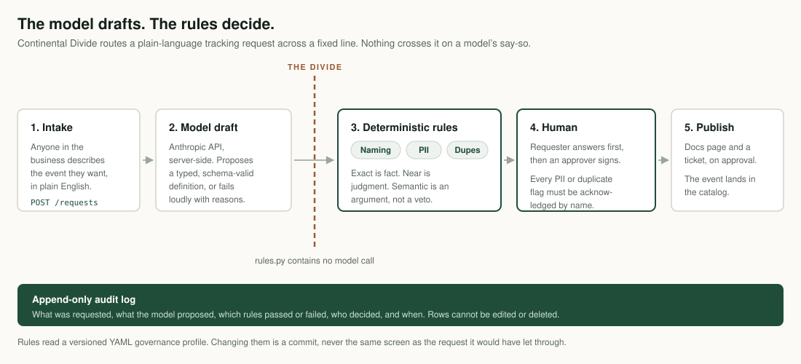
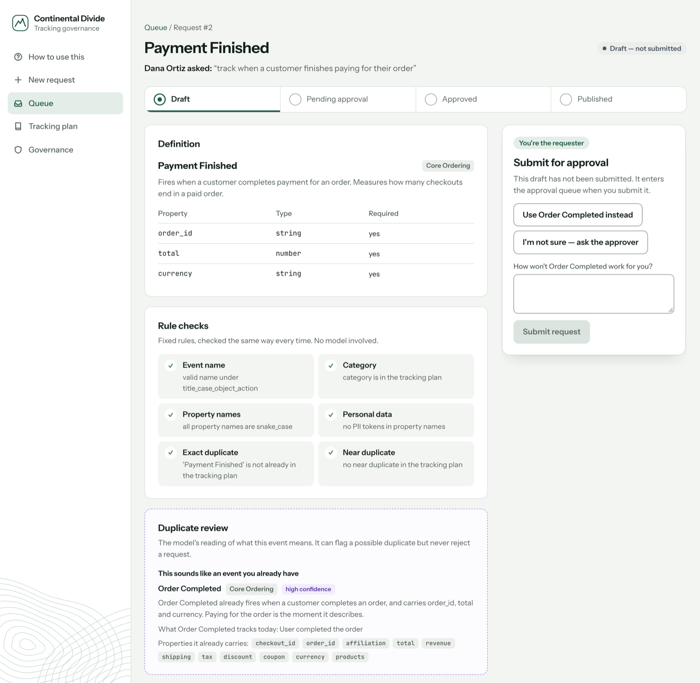
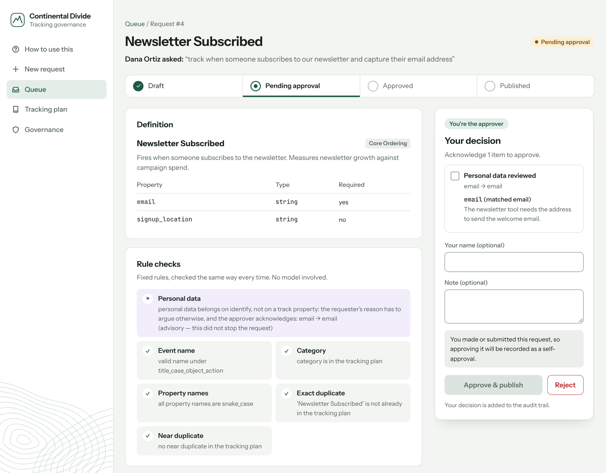
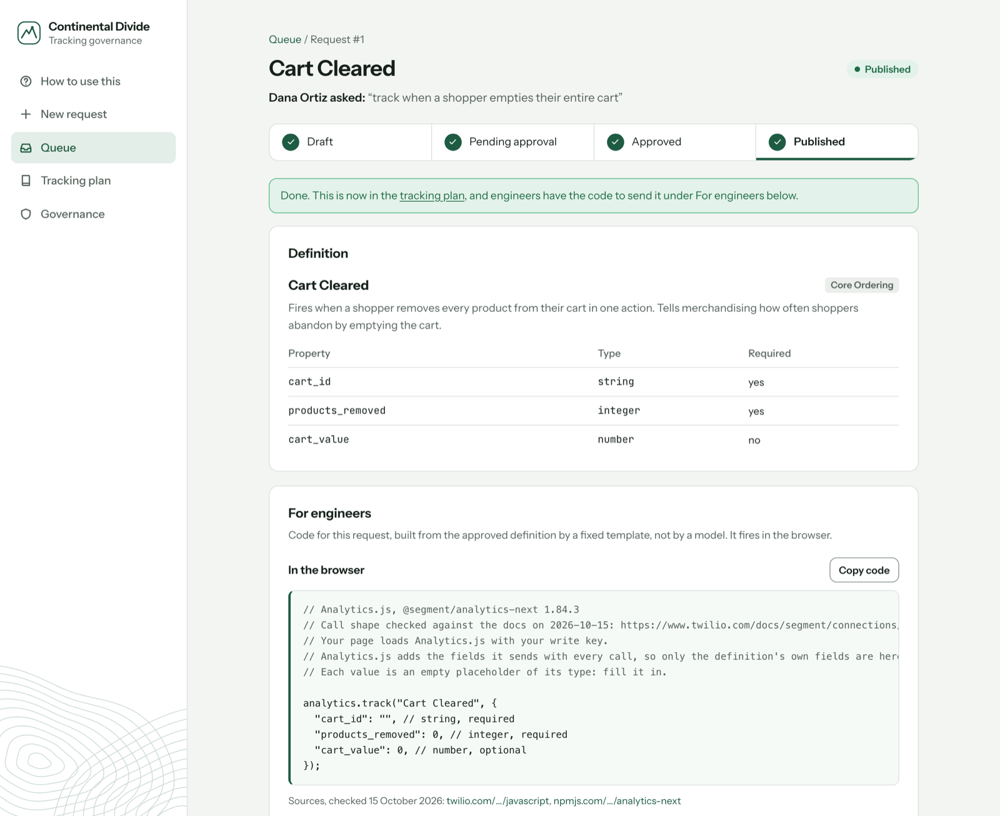
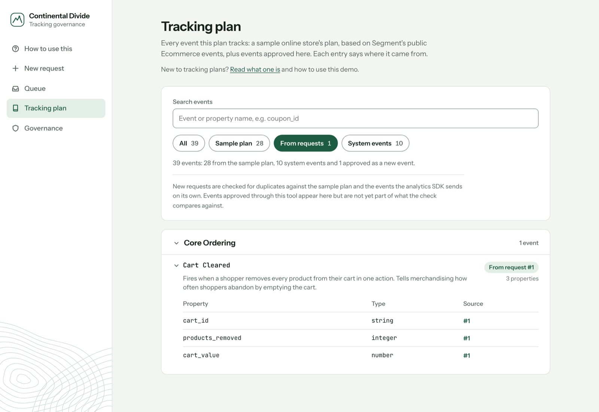
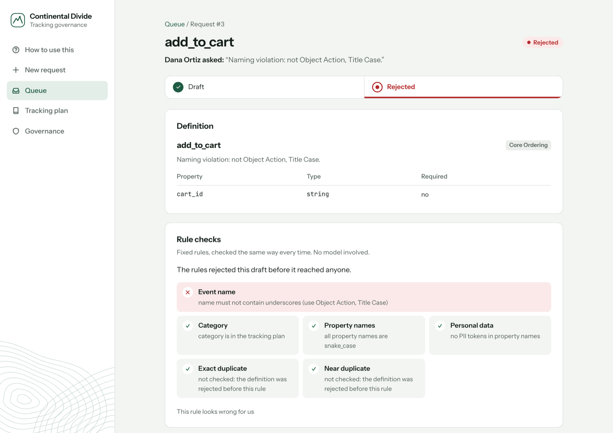
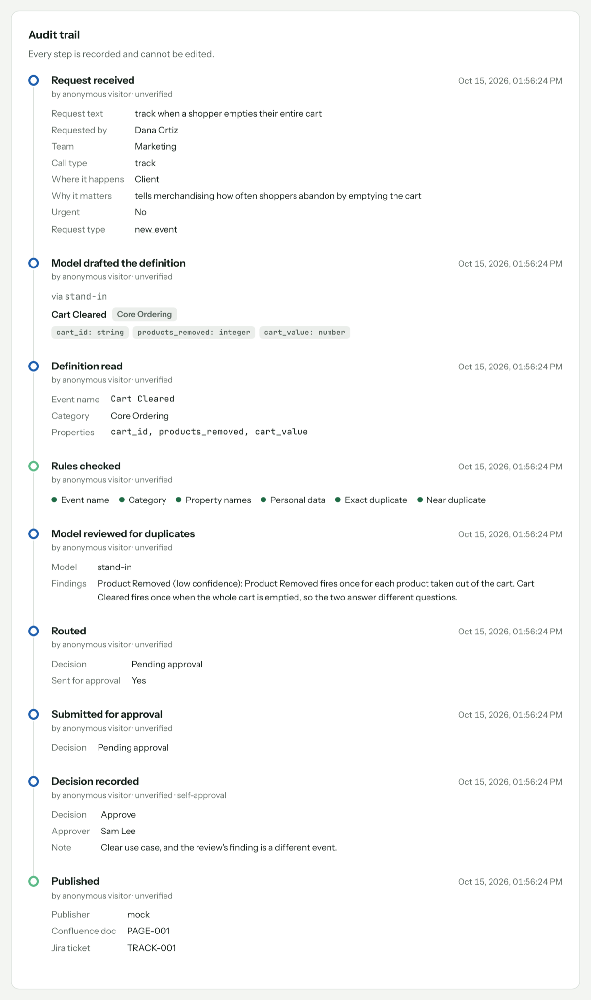
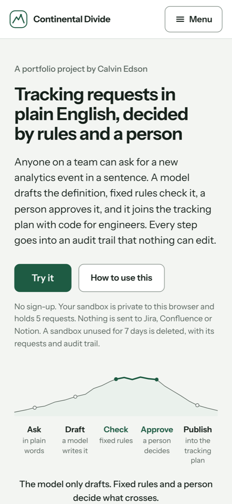

# Continental Divide

Continental Divide turns "I need to know something about our users" (asked in plain
English by anyone in a business) into a spec-compliant, human-approved, documented
tracked event.

**Try it at <https://continental-divide.vercel.app>.** There's no sign-up. Each visitor
gets a private sandbox that holds five requests and is deleted after seven days without
use. Nothing is sent to Jira, Confluence or Notion. You play both the requester and the
approver, so every approval is recorded as a self-approval.



I spent about a decade scoping and building tracking plans by hand, as a CSM at Segment,
managing the CDP at GoodRx, and again for a client this year. In each of those jobs the
tracking plan and production drifted apart until the plan stopped being true. Review was
one bottleneck. Teaching people what a good event looks like, and holding them to it, was
another. Continental Divide is a clean, open implementation of the pattern I kept
rebuilding.

A model drafts the event definition from a plain-language request. Deterministic rules
check its name, flag personal data and look for duplicates in the tracking plan. A person
approves it, and the approved event joins the tracking plan with Segment code for
engineers. Every step lands in an audit log that can't be edited. The model is fast and
useful and occasionally wrong, so it never decides.

A continental divide is the line that decides which way water flows. This tool is the line
a tracking request has to cross.

## How it works

1. **Ask.** Someone describes the event they want in plain language, with a note on why
   it matters, on a single-screen form or a guided five-step request for people who have
   never written an event before.
2. **Draft.** A model turns the request into a structured definition: a name, a category,
   a description and typed properties. It conforms to the schema or fails loudly with the
   reasons shown, and the request is kept at the status "Couldn't draft".
3. **Check.** Deterministic rules check the name against the naming convention, flag
   properties that look like personal data, and look for the same event in the tracking
   plan, whether written the same way or differently. A second model call reads the draft
   against the tracking plan and can point out an event that means the same thing under
   another name. That review is advisory and can never reject a request.
4. **Confirm.** The requester sees the draft and the findings before anyone else does. If
   it looks like an event that already exists, they can take the existing event, pass the
   question to the approver, or explain in writing why it won't work for them. Each
   property flagged as personal data needs a written reason. Nothing enters the approval
   queue until they submit.
5. **Approve.** An approver acknowledges each personal-data and duplicate flag by name
   before approving.
6. **Publish.** The event joins the tracking plan, where anyone can read what it means and
   which properties it carries. The tracking plan also lists the events Segment's
   libraries send on their own, with their properties, and the fields sent with every
   event, each with a link to Segment's docs and the date it was checked. Engineers get its Segment code for where it fires: the
   browser (Analytics.js), the server (Node), or both when the requester wasn't sure. The
   code comes from a fixed template checked against Segment's docs, and no model writes
   it. A mock publisher shows the Confluence page and Jira ticket a connected setup would
   create.



### What it looks like

These screenshots come from the demo's own pages running on fixture data. The rule checks,
duplicate findings, code and audit entries are the real engine's output. The drafted
definitions and the review's findings were written by hand to stand in for the model,
which is why the audit log names its model "stand-in".

A draft the review thinks already exists. The requester can take Order Completed, ask the
approver, or say why it won't work for them.



A request waiting on the approver, held until they acknowledge the personal-data flag and
the requester's reason for it.



A published request, with the Segment code engineers need to send it.



The tracking plan, showing where each event came from.



## Try the scenarios

The request form has a "Try a scenario" card. Each of its four scenarios shows a different
part of the contract. The first two go through the model. The last two skip it, so the
rules fire the same way every time. New to tracking plans? The demo's
[guide](https://continental-divide.vercel.app/guide) explains what one is and walks a
request through each step.

- **A clean request:** "track when a shopper empties their entire cart". The model drafts
  `Cart Cleared`, every rule passes, and approving it adds it to the tracking plan with its
  code.
- **Personal data:** "track when someone subscribes to our newsletter and capture their
  email address". The model drafts the `email` property as asked, and the personal-data
  rule flags it. The requester can't submit without writing why the request needs the
  address, and the approver can't approve without acknowledging that reason on the record.
  Nothing rejects it, and the requester and the approver both put their names on the
  exception.
- **A badly named event:** a ready-made `add_to_cart` definition. The naming rule rejects
  it for not being Object Action in Title Case. When the fix is only case or separators,
  as with `cart_cleared`, the engine offers a compliant name it has checked against its own
  rule, and one click resubmits under that name with the requester's consent recorded.
  `add_to_cart` needs its words reordered, so the engine offers no name. A requester who
  thinks the rule is wrong for them can say so on the record, which files a dispute and
  changes nothing.
- **An event that already exists:** a ready-made `Order Completed` definition, which the
  tracking plan already has. It's flagged as an exact duplicate and goes to the queue,
  where the approver has to acknowledge it.



## Three kinds of duplicate

Duplicate detection reports three kinds of finding, and each one is a different kind of
claim.

| Kind | What it is | Who decides |
| --- | --- | --- |
| **Exact** | The name is already in the plan, character for character | Fact. The approver acknowledges it. |
| **Near** | The same name written differently: case, separators, or a plural, with the same action verb | Deterministic judgment. The requester answers first. |
| **Semantic** | A model's argument that two differently-named events mean the same thing | Inference. High-confidence findings ask the requester; the rest are shown and cost nobody an action. |

None of the three can reject a request, and nothing reaches published until someone has
acknowledged what fired. The checks compare against the sample plan and the events the
analytics SDK sends on its own, such as Page Viewed and Application Opened, so a request
for an event Segment already sends is caught as a duplicate.
[`docs/adr/0001`](docs/adr/0001-three-tiers-of-duplicate-detection.md) records where the
seam sits and why, including a similarity threshold that was measured, produced two false
positives against Segment's own curated spec, and was dropped.

## Governance lives in a file

The rules come from a versioned YAML profile in [`governance/`](governance/): the naming
convention, the personal-data blocklist, the categories, and the allowed destinations. At
intake the profile is fixed and the model has no say in it. A team that disagrees with a
rule changes the profile in the setup wizard and commits the file, so the repo's history
is the profile's history.
[ADR 0006](docs/adr/0006-governance-profiles-are-versioned-and-edited-in-the-app.md)
decides the next step for a hosted instance with accounts: an admin saves numbered
versions in the app, each save goes into the audit log, and every request records the
version that judged it. That is not built yet. That change happens on its own screen and at its own time, apart from any request
it would let through.

The same rules can audit a whole tracking plan from the command line. From `backend/`,
`python -m app.vet <plan.json>` checks every event and property name, flags personal
data, and lists names within the plan that repeat or look alike. It reads only the file it is
given and writes nothing.

## How this was built

Claude Code wrote the code under my direction. My part was the product, data and design
calls, the rules the agent works under, and review of every change. The specification
is in the repo:

- [`CLAUDE.md`](CLAUDE.md): the standing instructions the agent works under. Architecture
  rules that need my sign-off to change, a frozen backward-compatibility test it may not
  edit, and the constraint that `rules.py` may never contain a model call.
- [`CONTEXT.md`](CONTEXT.md): the glossary. What each term means and which synonyms to
  avoid, so the code, the docs and the UI use the same word for the same thing.
- [`docs/adr/`](docs/adr/): why each decision was made and what it ruled out.
- [`TASKS.md`](TASKS.md): what's done, what's next, and what was deliberately cut.

An agent will agree with whoever is driving it. Most of what's written down exists to stop
that, with rules the model cannot reach, a test it cannot edit, and decisions recorded with
the evidence behind them, so a later session can't quietly reverse one.

Open any request in the demo and read its audit log. It reconstructs what happened and
why, in order, and no row in it can be edited or deleted.



## Stack

- Backend: Python and FastAPI, with Pydantic v2 for typed, validated outputs
- Frontend: Next.js and React, in TypeScript
- Drafting: the Anthropic API, server-side only
- Storage: SQLite for the audit log and request history, behind a storage interface
- Publishing: pluggable, and it runs on approval. A mock publisher ships by default, with
  a documented stub for a real Atlassian (Confluence and Jira) adapter
- Notion: a separate one-way push of a pending request to an approval board, on
  submission. It is not a publish target and Notion is not the system of record. The
  board is a place approvers already look. It is off in the public demo
- Hosting for the public demo: the frontend on Vercel, the backend on Render with a
  persistent disk

## The public demo

The public demo runs the same code as a local install, with demo mode on.
[ADR 0010](docs/adr/0010-a-public-demo-gives-each-visitor-a-private-sandbox.md) records the
design and [`docs/deploy.md`](docs/deploy.md) the setup. Strangers can draft with a paid
model, so these controls are in place:

- Each visitor gets their own SQLite file, picked by a signed cookie. Two sandboxes never
  see each other's requests or audit entries.
- Five requests per sandbox, counted where the request is stored, so no route can skip
  the count.
- A daily dollar budget for model calls, metered from token usage. Once it's spent,
  drafting stops and the two scenarios that skip the model keep working.
- Hourly limits on new sandboxes, per address and in total, a rate limit on every route a
  sandbox uses, and a size cap on every request body.
- Apart from a health check, the backend answers only requests that arrive through the
  Vercel site, which adds a shared secret and the visitor's address.
- No Notion push, and the publisher is the mock.

Two limits remain. There are no accounts. Every visitor is an anonymous, unverified actor,
so the audit log records what happened but not who did it. An idle sandbox is
deleted when a new visitor arrives after its seven days are up, so on a quiet stretch it
can outlast them.



## Running it locally

### Prerequisites

- Python: 3.9 works, 3.11+ recommended.
- Node.js LTS.
- An Anthropic API key (see Real-key setup below). The app runs without one, but drafting
  needs it.

### Start it

Two terminals: the backend on port 8000, the frontend on port 3000.

```bash
# Terminal 1: backend
cd backend
python -m venv .venv && source .venv/bin/activate
pip install -r requirements.txt
cp ../.env.example .env          # creates backend/.env, then add your key (next section)
uvicorn app.main:app --reload    # http://localhost:8000
```

```bash
# Terminal 2: frontend
cd frontend
npm install
cp .env.local.example .env.local
npm run dev                      # http://localhost:3000
```

Then open **http://localhost:3000**. Use `localhost`, not `127.0.0.1`. The backend pins
CORS to `http://localhost:3000`, so loading the UI from `127.0.0.1:3000` makes the
browser's API calls fail.

Locally the app runs in local mode, with one database, and every audit entry records the
address in `LOCAL_IDENTITY_EMAIL`. Every setting, with its default, is in
[`.env.example`](.env.example).

### Real-key setup

Drafting calls the Anthropic API server-side.

1. Get a key from the Anthropic Console (https://console.anthropic.com).
2. Put it in `backend/.env` as `ANTHROPIC_API_KEY=sk-ant-...`.
3. Never commit it. `backend/.env` is gitignored; only `.env.example` is tracked.

The key is read server-side only and never reaches the browser or any API response.
Without a key, `POST /requests` returns a 502 with a "could not draft a definition"
message and records a `model_error` step in the audit log. The request is still stored,
at the status "Couldn't draft" (`draft_failed`), and the rest of the app (queue, detail,
approve and reject, the scenarios that skip the model) still runs.

## Status

The full flow works end to end, locally and in the public demo. A pytest suite covers the
rules, the pipeline, the HTTP routes, the sandboxes and spend controls, the snippets and
the Notion mapping, alongside a deterministic eval tier whose fixtures pin engine
decisions one claim at a time. A Vitest suite covers the frontend. CI runs both, plus a
type-check and a production build, on every push.

**The bundled sample plan.** `backend/app/sample_tracking_plan.json` holds 28 events whose
names and descriptions are reproduced verbatim from Segment's public Ecommerce V2 spec
(<https://segment.com/docs/connections/spec/ecommerce/v2/>), used here as reference
material and credited to Segment.

**Known limits.**

- Duplicates are checked against the sample plan and the SDK's own events only. Events
  approved here appear in the tracking plan but aren't yet part of what the check compares
  against, so the tool could approve a duplicate of something it approved last week.
  [`docs/adr/0005`](docs/adr/0005-the-duplicate-corpus-grows-with-approved-events.md)
  decides how that changes. It lands after the live eval tier, because it changes the
  review's prompt.
- Nothing yet tests that the model reports only what the engine can't see and leaves
  alone what it already caught. That needs a live eval tier, which doesn't
  exist yet.
- Publishing is a mock. It shows the Confluence page and Jira ticket a connected setup
  would create, and the Atlassian adapter is a documented stub.
- Code for engineers covers Segment's Analytics.js and Node libraries. Python, raw HTTP
  and the other platforms come later.
- The personal-data rule matches tokens, so it only catches the names it knows. `Product
  Shared` and `Cart Shared` in the sample plan carry a `recipient` property, which in
  practice holds an email address or a phone number and passes the check clean. That is
  faithful to Segment's spec, so a plan copied from it carries the same unflagged
  identifier.
- `backend/run_examples.py` calls `reset_storage()`, which deletes the local SQLite file
  and recreates the tables, so running it wipes the local request history and the audit
  log.
- There are no accounts, locally or in the demo. See the public demo's limits above.

## Clean room

This is a clean-room rebuild. It carries no client code, data, names, or rules from any
prior engagement. The sample tracking plan follows Segment's public Ecommerce V2 spec and
uses generic example data; the naming convention follows Segment's public Track spec.
Secrets live in environment variables only and are never committed.

---

A portfolio project by Calvin Edson.
